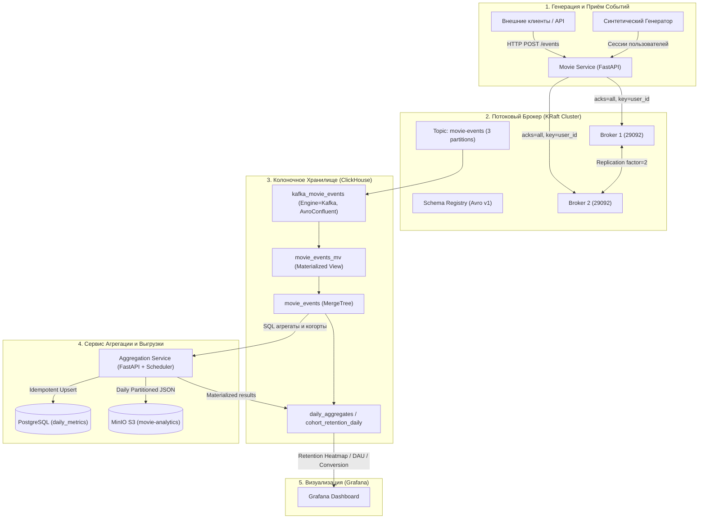

# Online Cinema: Event Streaming + Analytics Pipeline (HW #5)

Комплексный пайплайн обработки потоковых данных и аналитики для онлайн-кинотеатра.
Реализовано на 10 из 10 баллов (все три блока требований полностью покрыты).

---

## 🏛 Архитектура Системы



---

## 📋 Ответы для Защиты (Строго и Без Воды)

### Блок 1 (1–4 балла)

#### 1. Схема событий и обоснование ключа партиционирования

- **Формат схемы**: Apache Avro (`schemas/movie_event.avsc`), зарегистрированный в Confluent Schema Registry под именем `movie-events-value`.
- **Поля**: `event_id` (UUID), `user_id` (string), `movie_id` (string), `event_type` (enum), `timestamp` (long, logicalType `timestamp-millis`), `device_type` (enum), `session_id` (string), `progress_seconds` (nullable int).
- **Партиционирование топика**: Топик `movie-events` имеет **3 партиции** и `replication.factor = 2`.
- **Выбор ключа партиционирования (`user_id`)**:
  1. _Гарантия строгого порядка событий сессии_: в Kafka порядок гарантируется только внутри одной партиции. Жизненный цикл сессии просмотра пользователя строго последователен (`VIEW_STARTED` $\to$ `VIEW_PAUSED` $\to$ `VIEW_RESUMED` $\to$ `VIEW_FINISHED`). Партиционирование по `user_id` гарантирует, что все события одного пользователя попадают в одну партицию в точном хронологическом порядке.
  2. _Отсутствие перекосов нагрузки (Data Skew)_: популярность фильмов подчиняется степенному закону (топ-фильмы собирают 80% просмотров). Если бы партиционировали по `movie_id`, партиция с блокбастером была бы перегружена («горячая партиция»). Пользователи же распределены равномерно по хешу от `user_id`.
  3. _Когортный анализ и расчет Retention_: все вычисления когорт и возвращаемости базируются на пользователе. Локальность данных по пользователю упрощает потоковую агрегацию.

#### 2. Продюсер (Movie Service)

- **HTTP API (`POST /events`)**: Валидирует входной JSON через Pydantic и Avro-схему перед отправкой. При ошибке валидации возвращает HTTP 400/422. При успехе возвращает `event_id`.
- **Генератор синтетических данных**:
  - Реализует конечный автомат сессии: `VIEW_STARTED` ($progress=0$) $\to$ `VIEW_PAUSED` ($progress=X$) $\to$ `VIEW_RESUMED` $\to$ `VIEW_FINISHED` ($progress=Y > X$), а также сопутствующие события `SEARCHED` и `LIKED`.
  - Поддерживает bootstrap исторических данных за 10–14 дней для моментального наполнения когортного дашборда.
- **Отказоустойчивость**:
  - `acks='all'` - гарантия подтверждения записи брокерами перед ответом.
  - Exponential backoff retry - повторные попытки при кратковременных сбоях сети или брокеров.
  - Логирование публикаций: `event_id`, `event_type`, `timestamp`, `partition`, `offset`.

#### 3. ClickHouse: Приём и Хранение

- **Kafka Engine (`kafka_movie_events`)**: читает напрямую из Kafka с форматом `AvroConfluent`. На лету обращается к Schema Registry (`format_avro_schema_registry_url = 'http://schema-registry:8081'`), парсит бинарный Avro и преобразует типы данных.
- **MergeTree Storage (`movie_events`)**:
  - `PARTITION BY toYYYYMM(timestamp)`: партиционирование по месяцам позволяет эффективно удалять устаревшие партиции и дробить запросы по времени.
  - `ORDER BY (user_id, timestamp, event_type, session_id)`: разреженный индекс по пользователю и времени идеален для когортных выборок, восстановления сессий и расчета DAU.
- **Materialized View (`movie_events_mv`)**: непрерывно и автоматически вычитывает батчи из `kafka_movie_events` и вставляет их в `movie_events`.

#### 4. Интеграционный тест

- Тест запускается одной командой: `docker compose run --rm tests`.
- Публикует событие с уникальным UUID через HTTP API продюсера, опрашивает ClickHouse, верифицирует совпадение всех полей и проверяет корректность работы агрегатора и MinIO S3.

---

### Блок 2 (5–7 баллов)

#### 5. Сервис агрегации и выгрузка в PostgreSQL

- **Изоляция**: работает в отдельном контейнере `aggregator`, читает raw-события напрямую из ClickHouse (не из Kafka).
- **Бизнес-метрики**:
  1. `DAU`: `uniqExact(user_id)` за целевую дату.
  2. `Среднее время просмотра`: `avgIf(progress_seconds, event_type = 'VIEW_FINISHED')`.
  3. `Топ фильмов`: группировка по `movie_id` с подсчетом `VIEW_STARTED`.
  4. `Конверсия просмотра`: отношение `countIf(VIEW_FINISHED) / countIf(VIEW_STARTED) * 100%`.
  5. `Retention D1, D7`: доля пользователей, чья первая активность была за 1 (или 7) дней до даты и которые вернулись в целевой день.
- **Расписание и API**:
  - Фоновый планировщик (`APScheduler`) запускает пересчет каждые `N` минут (параметр `CALCULATION_INTERVAL_MINUTES`).
  - Ручной вызов через эндпоинт: `POST /aggregate?date=YYYY-MM-DD`.
  - Логирование: логирует старт и окончание каждого цикла с точным количеством обработанных сырых строк и временем в миллисекундах.
- **PostgreSQL**:
  - Таблица `daily_metrics (metric_date, metric_name, metric_value, dimensions, calculated_at)`.
  - Первичный ключ `(metric_date, metric_name)` обеспечивает **идемпотентность** через конструкцию `INSERT ... ON CONFLICT (metric_date, metric_name) DO UPDATE`.

---

### Блок 3 (8–10 баллов)

#### 6. Grafana Дашборд

- Datasource ClickHouse и дашборд развертываются автоматически при старте Grafana.
- Дашборд использует исключительно предрассчитанные агрегаты (`daily_aggregates`, `top_movies_daily`, `cohort_retention_daily`).
- **Когортный анализ (Retention Cohort Heatmap)**:
  - Строится сложным SQL-запросом:
    1. Находится дата первого события пользователя (когорта $C$).
    2. Вычисляется размер когорты.
    3. Для каждого смещения дня от 0 до 7 вычисляется процент вернувшихся пользователей:
       $$\text{Retention}_{D_k} = \frac{\text{Уникальные пользователи когорты } C \text{ с активностью в день } C + k}{\text{Размер когорты } C} \times 100\%$$
    4. Таблица визуализируется с цветовой шкалой (зеленый градиент), наглядно демонстрируя затухание retention от 100% на Day 0 до 15% на Day 7.
- **Дополнительные панели**: DAU (динамика), Конверсия (Gauge), Топ-10 фильмов (Bar chart), Среднее время просмотра (Stat), Динамика просмотров (Started vs Finished).

#### 7. Экспорт в S3 (MinIO)

- MinIO поднят в `docker-compose`.
- Формат файла: структурированный JSON со всеми агрегатами за день (`date`, `calculated_at`, `dau`, `conversion`, `retention_d1`, `retention_d7`, `top_movies`).
- Путь партиционирования: `s3://movie-analytics/daily/YYYY-MM-DD/aggregates.json`.
- Идемпотентность: повторный запуск перезаписывает объект без создания дубликатов.
- Ручной вызов: `POST /export?date=YYYY-MM-DD`.

#### 8. Отказоустойчивый кластер Kafka

- **2 брокера Kafka** (`broker1`, `broker2`) в режиме KRaft (без ZooKeeper, с общим кворумом контроллеров).
- Фактор репликации топика $\ge 2$, `min.insync.replicas = 1`.
- Confluent Schema Registry подключен к обоим брокерам.
- Для каждого сервиса настроены надежные `healthcheck`.

---

## 🚀 Быстрый Старт

### Запуск системы

```bash
docker compose up -d
```

_Все сервисы, таблицы в ClickHouse/PostgreSQL, топик в Kafka, Avro-схема, бакет в MinIO и дашборды в Grafana поднимутся и настроятся автоматически без ручных действий._

### Запуск тестов

```bash
docker compose run --rm tests
```

### Доступ к интерфейсам:

- **Grafana**: [http://localhost:3000](http://localhost:3000) (логин: `admin`, пароль: `admin`)
  - Дашборд доступен в папке _Online Cinema_ -> _Online Cinema Analytics_.
- **Movie Service (Producer API / Swagger)**: [http://localhost:8000/docs](http://localhost:8000/docs)
- **Aggregation Service API / Swagger**: [http://localhost:8001/docs](http://localhost:8001/docs)
- **MinIO Console (S3 UI)**: [http://localhost:9001](http://localhost:9001) (логин: `minioadmin`, пароль: `minioadmin`)
- **Schema Registry**: [http://localhost:8081/subjects](http://localhost:8081/subjects)
- **ClickHouse HTTP**: [http://localhost:8123/play](http://localhost:8123/play)
